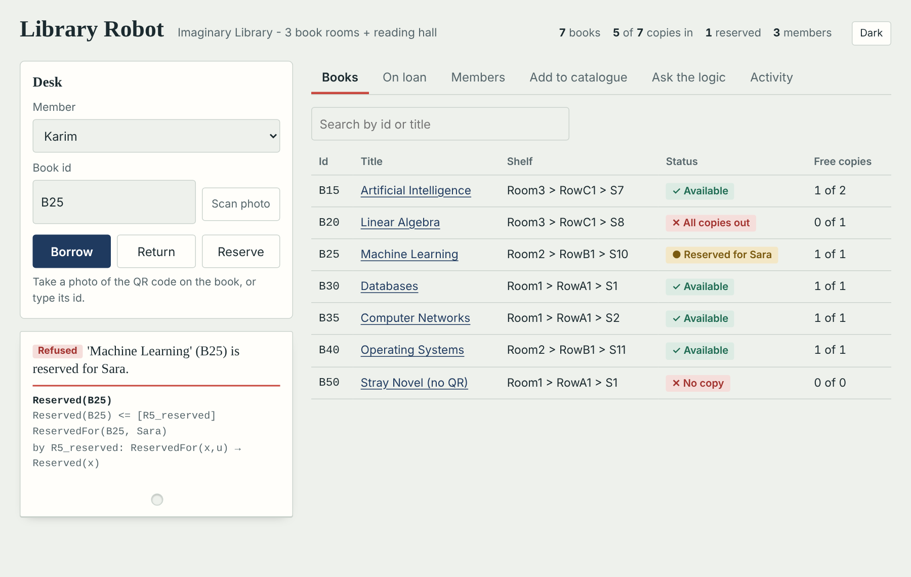
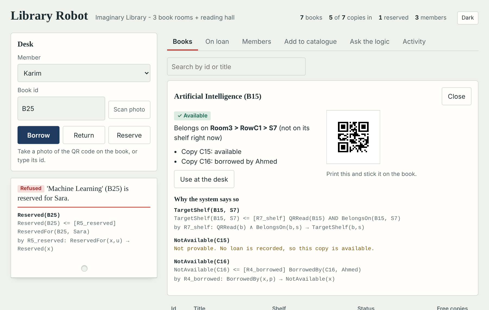
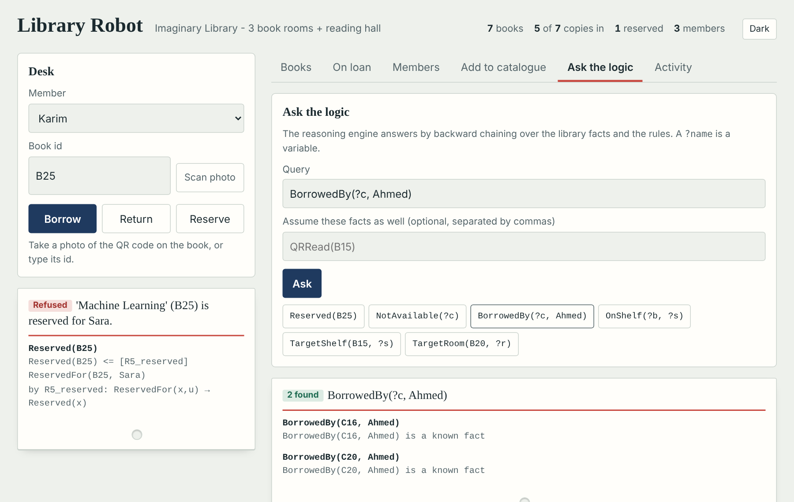
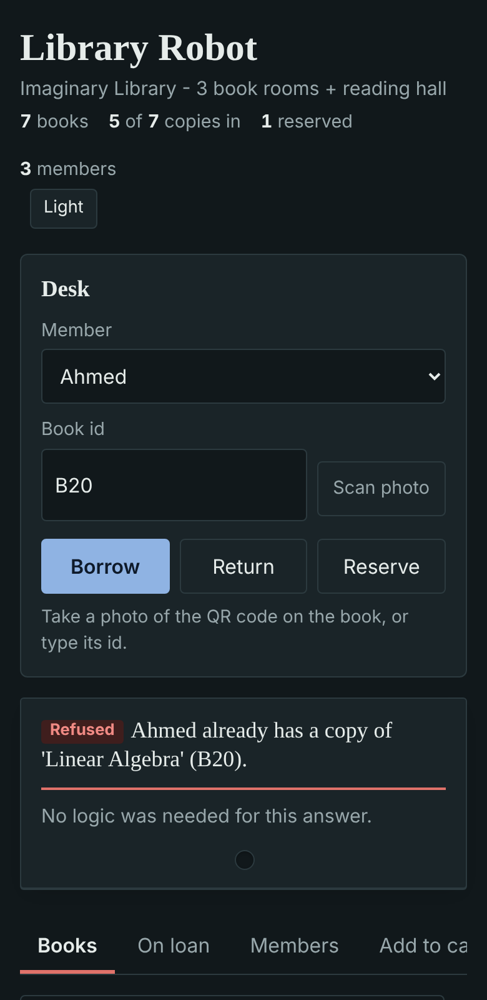

# Library Robot Brain

[](https://github.com/kaouthering/library-robot-krr/actions/workflows/tests.yml)

The brain of a library robot: a knowledge-based agent with a real camera, a database and a web interface.

A library assistant built on **Knowledge Representation & Reasoning**: First-Order Logic facts and rules,
unification, forward chaining, backward chaining and resolution. It does not follow `if/else` scripts. It holds
knowledge (facts and rules) and **infers** from it, so every decision comes with a **logical proof**.

It reads **real QR codes** (OpenCV), keeps the library in **SQLite**, and has a **web interface** where members
borrow, return and reserve books and see *why* the system answered the way it did.



```
 Camera / phone photo ──► QR decode (OpenCV) ──► Knowledge Base ◄── Rules (R1…R9) + Reasoning engine
                                                      ▲  │
 Web interface (Starlette) ──► service.py ────────────┘  ▼
 Command line (main.py)    ──────────────────────► SQLite database (library.db)
```

## What this project is

This is the **brain** of a library robot. It holds knowledge (facts and rules), infers decisions from it, and gives a
logical proof for every decision. It does not follow fixed if/else scripts.

The robot **body** (moving around, picking up books) is **simulated** in this version. Running it on real hardware
would need a robot platform, motors and a camera. Those parts are not included.

## What is real and what is simulated

| Part | Status |
|---|---|
| QR reading from webcam / phone camera / video / photo | **real** (OpenCV) |
| Books, copies, loans, reservations, shelves | **real, persistent** (SQLite) |
| Lending, returning, reserving, "where does this book go?" | **real**, decided by the logic engine, with proofs |
| Web interface (desk, catalogue, members, "ask the logic") | **real** |
| Object detection (book / chair / …) | optional, real with YOLO (`--yolo`) |
| Robot body (moving, picking up books) | **simulated** (map + Tkinter animation); no hardware needed |

## Install

```bash
pip install .                 # core: opencv-python, numpy
pip install ".[web]"          # + the web interface (starlette, uvicorn)
library-robot init            # creates library.db with a sample library
```

Python 3.10+. For development: `pip install -e ".[dev]"`.

## Web interface

```bash
library-robot serve                       # http://127.0.0.1:8000
library-robot serve --host 0.0.0.0        # also open it from a phone on the same Wi-Fi
```

* **Desk**: choose a member, type a book id or **scan a photo of its QR code**, then Borrow, Return or Reserve.
  The answer appears as a catalogue card with the proof (`Reserved(B25) <= [R5_reserved] ReservedFor(B25, Sara)`).
* **Books**: status, shelf, free copies; open a book for its QR code and the reasoning behind its status.
* **On loan / Members / Add to catalogue**: loans, members, new books and shelves.
* **Ask the logic**: type a query such as `BorrowedBy(?c, Ahmed)` and see the engine answer by backward chaining.
  You can also assume extra facts (`QRRead(B15)`) to see what would follow.

| Proof of a book's location | Ask the logic | Phone, dark mode |
|---|---|---|
|  |  |  |

JSON API (used by the page): `GET /api/books`, `GET /api/books/{id}`, `POST /api/checkout`, `/api/return`,
`/api/reserve`, `/api/ask`, `/api/scan` (image body), `GET /api/qr/{id}.png`, and more in `library_robot/web.py`.

> **No accounts yet.** Anyone who can open the page can lend and return books. Keep it on a trusted network.

## Command line

```bash
library-robot scan                                 # show a book to the camera: where it belongs, is it free?
library-robot checkout --user Ahmed                # scan a book and lend it to Ahmed
library-robot return   --user Ahmed                # scan a book and take it back
library-robot status                               # books, loans, reservations, last events
library-robot qr                                   # printable QR codes in qr_codes/ (print _sheet.png)

library-robot add-user Karim
library-robot add-shelf S20 Room3 RowC1
library-robot add-book B60 "Deep Learning" S20 --copies 2
library-robot reserve B60 Sara
```

Camera options: `--source 0` (webcam) · `--source http://PHONE_IP:8080/video` (phone with an "IP Webcam" app) ·
`--source photo.png` / `clip.mp4` (testing) · `--no-window` · `--yolo yolov8n.pt` (needs `pip install ultralytics`).
The database file is `./library.db`, or set `--db` / the `LIBRARY_DB` environment variable.

Example (`scan`):

```
  B15 - Artificial Intelligence
  belongs on : Room3 > RowC1 > S7
  proof      : TargetShelf(B15, S7)  <=  [R7_shelf]  QRRead(B15) AND BelongsOn(B15, S7)
  copy C15: available
  copy C16: BORROWED by Ahmed
```

## Simulation (no camera, nothing saved)

```bash
library-robot sim                       # console: the robot patrols, organizes books, serves customers
python -m library_robot.visual_robot    # same, with the animated map and the rule panel
```

## Project layout

| File | Role |
|---|---|
| `library_robot/knowledge_base.py` | facts, functions, rules, `target_of()` |
| `library_robot/rules.py` | inference rules (R1–R9) and action rules (A1–A18) |
| `library_robot/reasoning_engine.py` | unification, forward/backward chaining, resolution, ∃/∀ |
| `library_robot/database.py` | SQLite storage; builds the Knowledge Base from it; saves every change |
| `library_robot/service.py` | library operations with proofs (no web framework inside) |
| `library_robot/web.py`, `static/index.html` | web interface (Starlette) |
| `library_robot/sensors.py` | `SimulatedSensor` and `RealSensor` (camera, QR, optional YOLO) |
| `library_robot/robot.py` | the agent: patrol, organize, lend, return |
| `library_robot/main.py` | command-line tool |
| `library_robot/visual_robot.py` | Tkinter animation of the simulation |
| `tests/` | engine, service, web API and system tests |

## Tests

```bash
pip install -e ".[dev]"
pytest -q                 # or: python -m unittest
```

GitHub Actions runs the tests on Python 3.10, 3.12 and 3.13 for every push.

## QR format

The QR text is the book id (`B15`), or `LIB:B15`. Anything else is ignored. A QR that decodes to an id the
library does not know is treated like a book without a QR → Lost & Found.

## Limits / next steps

* The camera path was tested with generated QR images and video files, not with every camera model. Use a QR of
  at least ~3 cm and good light. Scanning in the web page uses a photo upload (works over plain HTTP on a phone);
  a live in-browser scanner needs HTTPS.
* No accounts or permissions, no due dates or reminders, and a reservation is not queued (any member who reserved
  the book may take it). SQLite serves one server process; use PostgreSQL for many users.
* A physical robot (navigation with SLAM/AprilTags, arm to pick up books) is not included.

License: MIT
